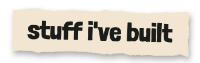
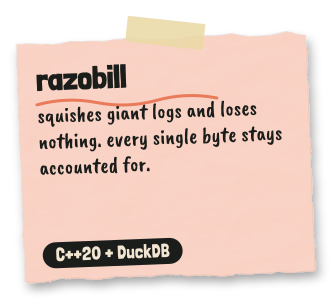
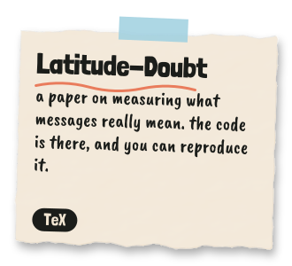
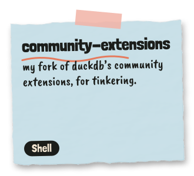
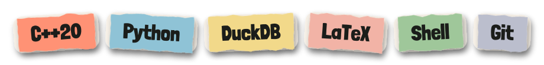
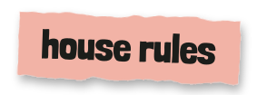

  

hey, i'm Moustafa, but online i'm **4t1a**, the one in the traffic cone. i'm a solo dev who likes data that stays exactly what it was: squishing logs without losing a byte, and counting what messages really mean. everything here is a work in progress, hence the cone.

  
  
  

  

  

1. Nothing gets thrown away without being counted.
2. If I claim it, the code to prove it ships with it.
3. Doubt gets a number, not a shrug.
4. The cone stays on.

- **Email:** [m.m.4t1a@gmail.com](mailto:m.m.4t1a@gmail.com)
- **ORCID:** [0009-0008-6724-4698](https://orcid.org/0009-0008-6724-4698)
- **Peerlist:** [mm4t1a](https://peerlist.io/mm4t1a)

  

